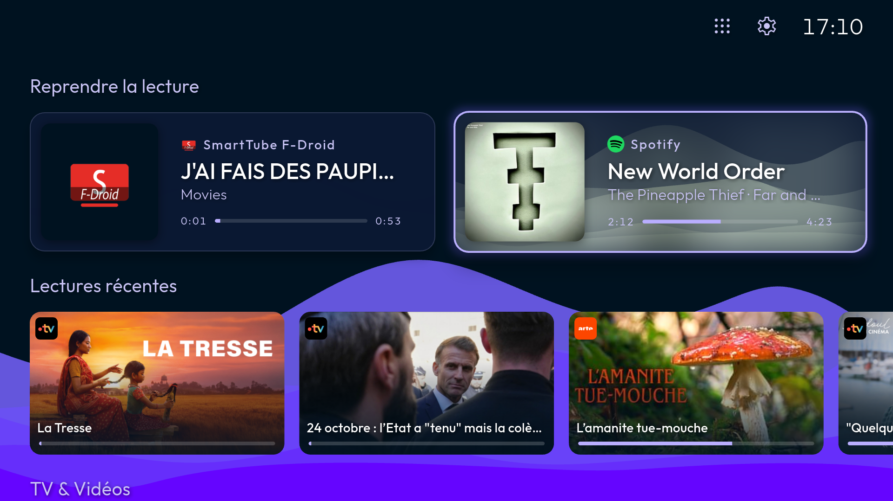
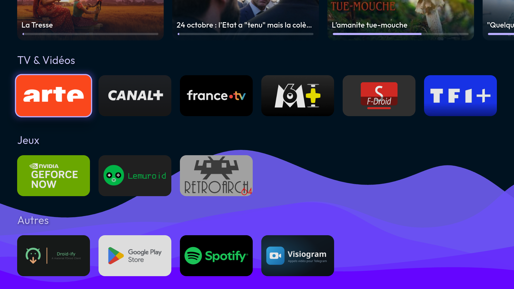
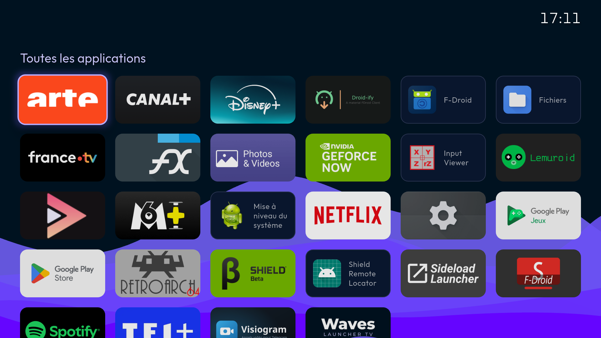
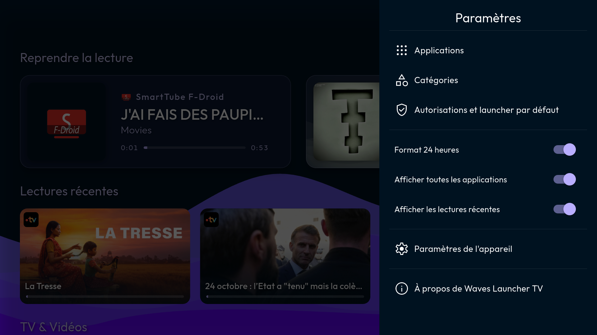

# Waves Launcher TV
Waves Launcher TV is an open-source alternative launcher for Android TV, built with [Flutter](https://flutter.dev). It is a fork of [FLauncher](https://gitlab.com/flauncher/flauncher) by Étienne Fesser, with a calmer look and the media you play at its heart.

## Features

### Home screen
- **Now playing**: the media playing on the TV, or on another device through Spotify Connect, shown at the top of the screen with its artwork through the waves, and controlled with the media keys of the remote
- **Recently played**: Android TV's "Play Next" programs, the last video watched and the last media of the apps playing in the background, such as Spotify, to resume them
- **Categories** of apps, shown as rows or grids, sorted alphabetically or manually, with their row height and number of columns to choose
- **All apps** page, opened from the top bar
- Clock, in 12 or 24 hour format
- Violet waves wallpaper, Outfit font and Material Symbols icons

### Navigation
- Pressing Home in the launcher goes back to the top of the page, and pressing it twice shows the recent apps
- Going up or down leads to the leftmost visible element of the next row
- Navigation sound feedback

### Apps
- Open, reorder, hide or uninstall an app, or open its info
- Support for non-TV (sideloaded) apps
- Shortcut to the Android settings
- No ads, no analytics

### Languages
- English, French, German, Italian, Portuguese and Spanish, following the language of the device
- English for any other language

## Screenshots
Taken on an NVIDIA Shield TV set to French.

| Home screen | Categories |
|--|--|
|  |  |
| **All apps** | **Settings** |
|  |  |

## Installation
These steps should work on any Android TV device, but they have only been tested on an NVIDIA Shield TV Pro (2019) running Android 11. The names of the settings and of the stock launcher differ from one device to another. The menus of the launcher are given with their English names.

**:warning: You are doing this at your own risk: disabling the stock launcher is done with `adb`, and you'll be responsible in any case of malfunction on your device.**

### 1. Connect to the device with `adb`
1. In the *About* screen of the settings, press *Build* 7 times to unlock the developer options. On the Shield, it is in *Settings > Device Preferences > About*.
2. In the developer options, enable the network debugging, which shows the address of the device. On the Shield, it is *Network debugging* in *Settings > Device Preferences > Developer options*.
3. Connect to it, and accept the prompt shown on the TV:
```shell
$ adb connect <address of the device>:5555
```

### 2. Install Waves Launcher TV
```shell
$ adb install app-release.apk
```

### 3. Disable the stock launcher
While it is still the default one, the stock launcher is given by the last line of:
```shell
$ adb shell cmd package resolve-activity --brief -a android.intent.action.MAIN -c android.intent.category.HOME
```

| Device | Stock launcher |
|--|--|
| NVIDIA Shield TV | `com.google.android.tvlauncher` |
| Chromecast with Google TV (untested) | `com.google.android.apps.tv.launcherx`, which `com.google.android.tungsten.setupwraith` re-enables unless it is disabled too |

```shell
$ adb shell pm disable-user --user 0 <stock launcher>
```
Once disabled, the settings of the device only remain as a fallback home, e.g. `com.android.tv.settings` on the Shield.

### 4. Set Waves Launcher TV as default launcher
As long as the stock launcher is enabled, Home opens it whatever the default launcher. Once it is disabled, this can be done from the settings of the launcher, in *Settings > Permissions and default launcher*, or with `adb`:
```shell
$ adb shell cmd package set-home-activity com.aurelienlustrement.waveslaunchertv/.MainActivity
```

### 5. Grant the accesses
The accesses the features need can be granted from the settings of the launcher, in *Settings > Permissions and default launcher*. Android TV devices often lack the settings screens of some of them though, which are then granted with `adb`:

```shell
# Recently played: the TV listings
$ adb shell pm grant com.aurelienlustrement.waveslaunchertv android.permission.READ_TV_LISTINGS
# Now playing: the notification access
$ adb shell cmd notification allow_listener com.aurelienlustrement.waveslaunchertv/com.aurelienlustrement.waveslaunchertv.MediaNotificationListener
# Recent apps on a double Home press: the accessibility service, which replaces any other enabled one
$ adb shell settings put secure enabled_accessibility_services com.aurelienlustrement.waveslaunchertv/com.aurelienlustrement.waveslaunchertv.RecentsAccessibilityService
$ adb shell settings put secure accessibility_enabled 1
```

### Re-enable the stock launcher
```shell
$ adb shell pm enable <stock launcher>
# lists the home activities, among which the one of the stock launcher, e.g. com.google.android.tvlauncher/.MainActivity on the Shield
$ adb shell cmd package query-activities --brief -a android.intent.action.MAIN -c android.intent.category.HOME
$ adb shell cmd package set-home-activity <home activity of the stock launcher>
```

## License
Waves Launcher TV is free software, released under the [GNU General Public License v3.0](LICENSE) or (at your option) any later version.

It is a modified version of [FLauncher](https://gitlab.com/flauncher/flauncher), copyright (C) 2021 Étienne Fesser, with contributions by Fernando Casas Schössow. It was forked from FLauncher's commit `4930cd7` and has been modified by Aurélien Lustrement since October 2026. The source files carry the copyright of both the original authors and the fork, according to who wrote them.

The [Outfit](https://github.com/Outfitio/Outfit-Fonts) font is licensed under the [SIL Open Font License 1.1](assets/fonts/outfit/OFL.txt).
